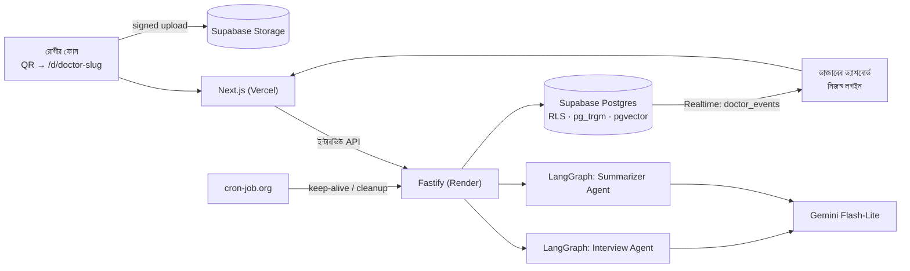

# ChamberTriage AI — আর্কিটেকচার, স্ট্যাক-সিদ্ধান্ত ও স্কেল-হিসাব

> ১৯ নভেম্বর ২০২৬ · এই ডকুমেন্ট কোডের সাথে মিলিয়ে লেখা। পুরনো প্ল্যান-ডকুমেন্ট (`ChamberTriage_Implementation_Guide*.md`) থেকে যেখানে বদলেছে, সেটা §৫-এ।

---

## ১. স্ট্যাক — কী এবং কেন

| স্তর | বাছাই | কেন |
|---|---|---|
| ভাষা | **TypeScript সব জায়গায়** (মনোরেপো) | ফ্রন্টএন্ড, ব্যাকএন্ড আর AI-আউটপুট — সবার একই Zod স্কিমা (`packages/shared`)। স্কিমা বদলালে দুই দিকেই টাইপ-এরর দেখায়, প্রোডাকশনে অমিল হয় না। |
| ফ্রন্টএন্ড | **Next.js (App Router) → Vercel** | Vercel-এর নিজের ফ্রেমওয়ার্ক — কনফিগ ছাড়াই ডেপ্লয়, প্রিভিউ-লিংক, CDN। |
| ব্যাকএন্ড | **Node.js + Fastify → Render** | হালকা ও দ্রুত; Render free-এর 512 MB RAM-এ আরামে চলে। Python + Presidio/spaCy সেখানে ভারী হতো। |
| AI এজেন্ট | **LangGraph.js** | দুটো এজেন্ট: Interview (প্রশ্ন-উত্তরের স্টেট মেশিন, Postgres checkpoint) ও Summarizer (ছবি পড়া + সামারি + যাচাই)। |
| LLM | **Gemini Flash-Lite** (`@google/genai`) | ফ্রি টিয়ার আছে; মডেলের নাম `.env`-এ — বদলাতে কোড লাগে না। `MOCK_LLM=true` দিলে key ছাড়াই পুরো অ্যাপ চলে। |
| ডাটাবেস + লগইন + ফাইল + রিয়েল-টাইম | **Supabase** | একটা প্রজেক্টেই Postgres, Auth, Storage, Realtime, pgvector, pg_trgm। |
| কিউ ও রেট-লিমিট | **Postgres দিয়েই** (`jobs`, `rate_limits`) | Redis-এর মতো বাড়তি সার্ভিস ছাড়াই একাধিক সার্ভারে সঠিক কাজ করে। |

### কেন এই ডিজাইনে পরে প্রোডাকশনে সমস্যা হবে না
1. **API stateless** — ইন্টারভিউ-স্টেট Postgres-এ (LangGraph checkpointer)। Render-এ সার্ভার ১টা থেকে ১০টা করলে কোড বদলাতে হয় না।
2. **ধীর কাজ আলাদা কিউতে** — সামারি তৈরি `jobs` টেবিলে (FOR UPDATE SKIP LOCKED)। বড় স্কেলে একই কোড আলাদা Render Background Worker-এ `RUN_WORKER=true` দিয়ে চালানো যায়, API-তে `RUN_WORKER=false`।
3. **ছবি সার্ভারে আসে না** — ফোন থেকে সরাসরি Supabase Storage-এ signed URL দিয়ে।
4. **সব সীমা ও মডেল `.env`-এ** — ফ্রি থেকে পেইডে যেতে শুধু সংখ্যা বদলান (`DAILY_RPD_*`, `plan`, `numInstances`)।
5. **কোনো ভেন্ডর-লক নেই** — Postgres স্ট্যান্ডার্ড SQL; Render ছাড়া যেকোনো Node হোস্টে চলে; Vercel ছাড়া যেকোনো Next.js হোস্টে চলে।

---

## ২. সিস্টেম-চিত্র



### Interview Agent
```
START → start → ask ⇄ process → redflags → plan ─┬→ ask (পরের প্রশ্ন)
                                                ├→ comorbid → photos → END
                                                └→ END (emergency)
```
- `ask`, `comorbid`, `photos` = `interrupt()` — রোগীর উত্তরের জন্য থামে।
- `process` = AI (মোড/কোটা অনুযায়ী) + সবসময় কীওয়ার্ড-নিয়ম (না-বাচক শব্দ বুঝে: "ঘাম হয় না" ≠ ঘাম)।
- `redflags` = নির্ধারিত নিয়ম — AI-এর ওপর নির্ভর করে না।
- `plan` = প্রশ্ন-ব্যাংক থেকে, যে স্লট খালি সেই প্রশ্ন; আগে পূরণ হলে বাদ।

### Summarizer Agent
```
START → generate (ছবি + সামারি একটি AI কলে) → postprocess (KB দিয়ে জেনেরিক, কোডে ল্যাব High/Low)
      → verify (প্রতিটি তথ্যের উৎস আছে? রোগ-নির্ণয় ঘোষণা নেই?) ─┬→ generate (সর্বোচ্চ ২ বার)
                                                               └→ END
```

---

## ৩. নিরাপত্তা-মডেল (নতুন চাহিদা অনুযায়ী)

| চাহিদা | কীভাবে নিশ্চিত |
|---|---|
| এক ডাক্তার আরেকজনের **ড্যাশবোর্ডে লগইন করতে পারবেন না** | প্রত্যেকের আলাদা Supabase অ্যাকাউন্ট (ইমেইল + পাসওয়ার্ড), পাবলিক সাইন-আপ বন্ধ, অ্যাকাউন্ট শুধু অ্যাডমিন বানান। ড্যাশবোর্ডের প্রতিটি রিকোয়েস্টে সার্ভার টোকেন যাচাই করে টোকেনের মালিকের ডেটাই দেয় — URL বা আইডি বদলে অন্যের তালিকা পাওয়া যায় না। প্রথম লগইনে পাসওয়ার্ড বদলানো বাধ্যতামূলক। নিষ্ক্রিয় করলে লগইনও বন্ধ (ban)। |
| ড্যাশবোর্ডের তালিকায় **শুধু নিজের রোগী** | `GET /api/doctor/visits` সবসময় `doctor_id = টোকেনের মালিক`। Realtime-ও RLS দিয়ে শুধু নিজের ইভেন্ট। |
| **অন্য ডাক্তারের রোগী কোড দিয়ে সার্চ করে দেখা যাবে** | `GET /api/doctor/search?code=` সব ডাক্তারের রোগীর মধ্যে খোঁজে; ফলাফলে কার রোগী তা দেখায়। |
| ক্রস-ডাক্তার অপব্যবহার ঠেকানো | (১) কোড এখন **৬ অঙ্কের** (৯ লাখ সম্ভাবনা; দিনে ৩,৩০০ রোগী হলেও আন্দাজে মেলার সম্ভাবনা প্রতি চেষ্টায় ~০.৩৭%)। (২) সব সার্চে ঘণ্টায় ৩০০ সীমা, অন্য ডাক্তারের রোগী পেলে ঘণ্টায় ৬০ সীমা। (৩) প্রতিটি ক্রস-সার্চ ও ক্রস-দেখা `audit_logs`-এ। (৪) অন্য ডাক্তারের রোগীর বিস্তারিত শুধু সার্চের পর ১২ ঘণ্টা দেখা যায় — শুধু ভিজিট-আইডি জানলে খোলে না। (৫) রোগীর সম্মতিপত্রে এটা স্পষ্ট লেখা আছে। |
| রোগীর সেশন | কোড ছাড়াও ব্রাউজারে আলাদা ৩২-বাইটের গোপন key; DB-তে শুধু hash। কোড জেনে কেউ রোগীর সেশনে ঢুকতে পারে না। |
| ব্যক্তিগত তথ্য | নাম/ফোন চাওয়া হয় না; বললে মাস্ক; ছবিতে রোগীর নাম AI-কে এক্সট্র্যাক্ট করতে নিষেধ; ছবি ১৪ দিনে মুছে যায়। |

---

## ৪. স্কেল-হিসাব: ৫০,০০০ – ১,০০,০০০ ইউজার

**ধরে নেওয়া:** "ইউজার" = মাসে এত রোগী-ইন্টারভিউ। ৮০% ভিড় সন্ধ্যা ৫টা–১০টায়; একটা ইন্টারভিউ ~৬ মিনিট, ~১৪টি API রিকোয়েস্ট, ৫টি AI কল; ছবি রোগী-প্রতি ২টি × ১৫০ KB; ডাক্তার-প্রতি মাসে ~৭৮০ ইন্টারভিউ।

| মেট্রিক | ৫০,০০০/মাস | ১,০০,০০০/মাস |
|---|---|---|
| দিনে ইন্টারভিউ | ~১,৬৬৭ | ~৩,৩৩৩ |
| ভিড়ের ঘণ্টায় | ~২৬৭ | ~৫৩৩ |
| একই সময়ে চলমান ইন্টারভিউ | ~২৭ | ~৫৩ |
| API লোড (ভিড়ে) | ~১ রিকোয়েস্ট/সেকেন্ড | ~২ রিকোয়েস্ট/সেকেন্ড |
| AI কল/দিন (ভিড়ে প্রতি মিনিটে) | ~৮,৩০০ (~২২) | ~১৬,৭০০ (~৪৪) |
| নতুন ডাটাবেস-ডেটা/মাস | ~১ GB | ~২ GB |
| ছবি (১৪ দিন রাখলে) | ~৭ GB | ~১৪ GB |
| ডাক্তার (আনুমানিক) | ~৬৪ | ~১২৮ |

**সিদ্ধান্ত:** API-লোড Node-এর জন্য খুবই কম — একটা পেইড ইনস্ট্যান্সই যথেষ্ট, নিরাপত্তার জন্য ২টা। আসল সীমা AI-কোটা আর ডাটাবেস/স্টোরেজ সাইজ।

### ফ্রি টিয়ার কতদূর
| সম্পদ | ফ্রি সীমা | কতজনে ফুরায় |
|---|---|---|
| Gemini Flash-Lite | প্রতি মডেলে দিনে ~৫০০ কল, মিনিটে ১০ | দিনে ~১০০ পূর্ণ-AI ইন্টারভিউ; এরপর সাশ্রয়ী মোড (দিনে ~৪০০ পর্যন্ত) |
| Supabase DB | 500 MB | মাসে ~৫,০০০ ইন্টারভিউয়ে ~৬ মাস |
| Supabase Storage | 1 GB | দিনে ~১০০ ইন্টারভিউ (১৪ দিনের নীতিতে) |
| Render | 512 MB, ১৫ মিনিটে ঘুম | পাইলট পর্যন্ত ঠিক আছে |
| Vercel Hobby | অ-বাণিজ্যিক | টাকা নেওয়া শুরু করলে বদলাতে হবে |

👉 **ফ্রি = হ্যাকাথন + ২–৩ জন ডাক্তারের পাইলট (দিনে ~১০০ রোগী পর্যন্ত, সিন্থেটিক ডেটা)।** ৫০k–১ লাখে পেইড লাগবেই।

### ৫০k–১ লাখে আনুমানিক মাসিক খরচ
| সার্ভিস | কী নেবেন | আনুমানিক খরচ |
|---|---|---|
| Gemini (পেইড টিয়ার, Flash-Lite) | রোগী-প্রতি ~$0.008 (অনুমান) | ৫০k: ~$410 · ১ লাখ: ~$820 |
| Render | ২টি পেইড ইনস্ট্যান্স (ঘুম নেই) | পেইড ইনস্ট্যান্স মাসে $7 থেকে শুরু |
| Supabase Pro | DB 8 GB, ফাইল 100 GB, ব্যাকআপ, pause নেই | $25 + ব্যবহার |
| Vercel Pro | বাণিজ্যিক ব্যবহার | $20/সিট |
| কাস্টম SMTP | পাসওয়ার্ড-রিসেট ইমেইল | ফ্রি/সস্তা প্রোভাইডার |
| **মোট** | | **~$500 (৫০k) – ~$950 (১ লাখ)** |

আয়ের দিকে: ১ লাখ ইন্টারভিউ ≈ ~১২৮ জন ডাক্তার; মাসে ৳২,৫০০ করে নিলেও ~৳৩.২ লাখ — খরচের (~৳১.১৫ লাখ) চেয়ে বেশি। (Gemini-র দাম বদলায় — `/docs`-এর আসল মাপা টোকেন দিয়ে হিসাব হালনাগাদ করুন।)

### ফ্রি → প্রোডাকশন: কোড না বদলে যা করবেন
1. Gemini-তে বিলিং চালু → `DAILY_RPD_TURN`/`DAILY_RPD_FINAL`-এ AI Studio-র নতুন সীমা।
2. `render.yaml`: `plan: starter` (বা বড়), `numInstances: 2`; চাইলে আলাদা worker সার্ভিস (`RUN_WORKER=true`), API-তে `RUN_WORKER=false`।
3. Supabase Pro; `DB_POOL_MAX` ইনস্ট্যান্স-প্রতি ৫–১০।
4. Vercel Pro (বা অন্য হোস্ট)।
5. Supabase-এ কাস্টম SMTP।
6. মনিটরিং: Render লগ + `/api/metrics`; প্রয়োজনে Sentry।
7. ১ লাখ/দিন হলে: পুরনো ভিজিট আর্কাইভ, `visits` মাসভিত্তিক partition, read-replica — এগুলো তখনকার কাজ, এখন নয়।

---

## ৫. আগের প্ল্যান থেকে যা বদলেছে

| আগে | এখন | কারণ |
|---|---|---|
| ব্যাকএন্ড Python + FastAPI | **Node.js + Fastify** (TypeScript) | এক ভাষা, শেয়ার্ড স্কিমা, Render free-তে হালকা |
| Presidio (Python) | TypeScript-এ একই pattern-recognizer পদ্ধতি (`lib/pii.ts`) | Node-এ Presidio নেই; নাম/ফোন চাওয়াই হয় না |
| ৪ অঙ্কের কোড, প্রতি ডাক্তারে আলাদা | **৬ অঙ্কের কোড, দিনে সব ডাক্তার মিলিয়ে অনন্য** | ক্রস-ডাক্তার সার্চ ও ১ লাখ স্কেলে সংঘর্ষ/আন্দাজ ঠেকাতে |
| ডাক্তার শুধু নিজের রোগী দেখেন | **নিজের তালিকা + সব ডাক্তারের রোগী কোড-সার্চে** (অডিটসহ) | আপনার নতুন চাহিদা |
| ড্যাশবোর্ড সরাসরি Supabase RLS থেকে পড়ে | **API দিয়ে পড়ে**; Supabase Realtime শুধু নোটিফিকেশন | ক্রস-ডাক্তার নিয়ম, অডিট ও রেট-লিমিট এক জায়গায় রাখতে |
| RAGAS (Python) | `verify` নোডে নিয়মভিত্তিক faithfulness-চেক | Node-এ RAGAS নেই; গোল্ডেন-সেট ইভ্যাল আলাদা স্ক্রিপ্টে পরে যোগ করা যায় |
